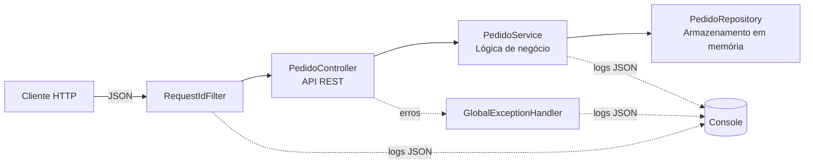

# API de Pedidos — CP5 SOA

## Integrantes

| Nome | RM |
|---|---|
| Guilherme Nunes | 558989 |
| Kaique Zaffarani | 556677 |
| Pedro Josué | 554913 |

## Tecnologias

- **Linguagem:** Java 21
- **Framework:** Spring Boot 3.5
- **Documentação:** OpenAPI 3.1 / Swagger UI (springdoc-openapi)
- **Testes:** JUnit 5 + MockMvc
- **Logs:** logs estruturados em JSON (formato Logstash, nativo do Spring Boot)
- **Persistência:** em memória (`ConcurrentHashMap`)

## Arquitetura



| Componente | Responsabilidade |
|---|---|
| `RequestIdFilter` | Gera ou reaproveita o `X-Request-Id`, coloca o `requestId` no contexto de log e registra o fim de cada requisição. |
| `PedidoController` | Entrada HTTP: expõe as rotas, valida o corpo JSON e define os códigos de status. |
| `PedidoService` | Lógica de negócio: cria o pedido com identificador e status `CRIADO` e realiza a consulta por identificador. |
| `PedidoRepository` | Armazena e recupera os pedidos em memória. |
| `GlobalExceptionHandler` | Converte erros (pedido inexistente, dados inválidos, UUID inválido) em respostas JSON padronizadas. |

## Endpoints

| Método | Caminho | Descrição | Status |
|---|---|---|---|
| `POST` | `/pedidos` | Cria um pedido | `201`, `400`, `500` |
| `GET` | `/pedidos/{id}` | Consulta um pedido por identificador | `200`, `400`, `404`, `500` |

## OpenAPI / Swagger

- Especificação no repositório: [`docs/openapi.yaml`](docs/openapi.yaml)
- Swagger UI (com a API em execução): http://localhost:8080/swagger-ui.html
- Especificação gerada em execução: http://localhost:8080/v3/api-docs

## Como executar a API

Pré-requisito: **JDK 21 ou superior** instalado. Não é necessário instalar o Maven (o projeto usa o Maven Wrapper).

1. Clone o repositório:
   ```bash
   git clone https://github.com/Z4ffarani/CP5-SOA.git
   cd CP5-SOA
   ```
2. Inicie a API:
   ```bash
   ./mvnw spring-boot:run
   ```
   No Windows (PowerShell ou CMD):
   ```powershell
   chcp 65001
   .\mvnw.cmd spring-boot:run
   ```
   O `chcp 65001` configura o terminal em UTF-8 para exibir corretamente os acentos dos logs. Ele deve ser executado no mesmo terminal, antes de iniciar a API, e vale apenas para aquele terminal. Sem ele, os acentos aparecem trocados (ex.: `n├úo`) apenas na exibição; o conteúdo gerado pela API está correto.
3. A API fica disponível em `http://localhost:8080`.

## Exemplos de requisição e resposta

### Criar pedido — `201 Created`

```bash
curl -i -X POST http://localhost:8080/pedidos \
  -H "Content-Type: application/json" \
  -d '{"cliente":"Maria Silva","descricao":"Notebook Dell Inspiron 15","valor":4599.90}'
```

```http
HTTP/1.1 201
X-Request-Id: 7c1e9a2b-4d3f-4e8a-b5c6-0f1e2d3c4b5a
Location: http://localhost:8080/pedidos/7096cb95-c2fa-4368-858b-d3269d07594a
Content-Type: application/json
```

```json
{
  "id": "7096cb95-c2fa-4368-858b-d3269d07594a",
  "cliente": "Maria Silva",
  "descricao": "Notebook Dell Inspiron 15",
  "valor": 4599.90,
  "status": "CRIADO",
  "dataCriacao": "2026-10-22T00:35:22.985052916Z"
}
```

### Consultar pedido — `200 OK`

```bash
curl -i http://localhost:8080/pedidos/7096cb95-c2fa-4368-858b-d3269d07594a
```

```json
{
  "id": "7096cb95-c2fa-4368-858b-d3269d07594a",
  "cliente": "Maria Silva",
  "descricao": "Notebook Dell Inspiron 15",
  "valor": 4599.90,
  "status": "CRIADO",
  "dataCriacao": "2026-10-22T00:35:22.985052916Z"
}
```

### Consultar pedido inexistente — `404 Not Found`

```bash
curl -i http://localhost:8080/pedidos/00000000-0000-0000-0000-000000000000
```

```json
{
  "timestamp": "2026-10-22T00:35:23.028375266Z",
  "status": 404,
  "erro": "Pedido não encontrado",
  "detalhes": ["Pedido 00000000-0000-0000-0000-000000000000 não encontrado"],
  "caminho": "/pedidos/00000000-0000-0000-0000-000000000000",
  "requestId": "be18d2aa-c62a-4a7b-958d-843452a6be93"
}
```

### Criar pedido com dados inválidos — `400 Bad Request`

```bash
curl -i -X POST http://localhost:8080/pedidos \
  -H "Content-Type: application/json" \
  -d '{"cliente":"","descricao":"Mouse","valor":-10}'
```

```json
{
  "timestamp": "2026-10-22T00:35:23.05791525Z",
  "status": 400,
  "erro": "Dados inválidos",
  "detalhes": ["cliente é obrigatório", "valor deve ser maior que zero"],
  "caminho": "/pedidos",
  "requestId": "293a0d74-7075-45d4-af11-a6e8b52fe1b3"
}
```

### Consultar com identificador inválido — `400 Bad Request`

```bash
curl -i http://localhost:8080/pedidos/abc
```

```json
{
  "timestamp": "2026-10-22T00:35:23.07779594Z",
  "status": 400,
  "erro": "Identificador inválido",
  "detalhes": ["O identificador deve ser um UUID válido"],
  "caminho": "/pedidos/abc",
  "requestId": "0b0760be-219c-4719-84ae-b33aa9bf2ab2"
}
```

## Teste automatizado

Arquivo: [`src/test/java/br/com/fiap/pedidos/PedidoControllerTest.java`](src/test/java/br/com/fiap/pedidos/PedidoControllerTest.java)

| Teste | Verificação |
|---|---|
| `deveCriarPedido` | `POST /pedidos` retorna `201`, cabeçalho `Location` e `status` = `CRIADO`. |
| `deveConsultarPedidoCriado` | `GET /pedidos/{id}` de um pedido criado retorna `200` com os dados do pedido. |
| `deveRetornar404ParaPedidoInexistente` | `GET /pedidos/{id}` com identificador inexistente retorna `404`. |
| `deveRetornar400ParaDadosInvalidos` | `POST /pedidos` com dados inválidos retorna `400`. |

### Como executar

```bash
./mvnw test
```

No Windows (PowerShell ou CMD):

```powershell
.\mvnw.cmd test
```

### Evidência da execução

```text
[INFO] -------------------------------------------------------
[INFO]  T E S T S
[INFO] -------------------------------------------------------
[INFO] Running br.com.fiap.pedidos.PedidoControllerTest
[INFO] Tests run: 4, Failures: 0, Errors: 0, Skipped: 0, Time elapsed: 3.017 s -- in br.com.fiap.pedidos.PedidoControllerTest
[INFO]
[INFO] Results:
[INFO]
[INFO] Tests run: 4, Failures: 0, Errors: 0, Skipped: 0
[INFO]
[INFO] ------------------------------------------------------------------------
[INFO] BUILD SUCCESS
[INFO] ------------------------------------------------------------------------
```

## Logs estruturados

Os logs são emitidos no console em JSON. Cada registro contém:

| Campo | Conteúdo |
|---|---|
| `@timestamp` | Data e hora |
| `level` | Nível do log (`INFO`, `WARN`, `ERROR`) |
| `message` | Mensagem descritiva |
| `operacao` | Operação executada (`CRIAR_PEDIDO`, `CONSULTAR_PEDIDO`) |
| `requestId` | Identificador da requisição (enviado no cabeçalho `X-Request-Id` ou gerado pela API) |
| `pedidoId` | Identificador do pedido |

### Evidência

Logs gerados pela aplicação durante as requisições dos exemplos acima:

```json
{"@timestamp":"2026-10-22T00:35:22.986513428Z","@version":"1","message":"Pedido criado com sucesso","logger_name":"br.com.fiap.pedidos.service.PedidoService","thread_name":"http-nio-8080-exec-4","level":"INFO","level_value":20000,"pedidoId":"7096cb95-c2fa-4368-858b-d3269d07594a","requestId":"7c1e9a2b-4d3f-4e8a-b5c6-0f1e2d3c4b5a","operacao":"CRIAR_PEDIDO","status":"CRIADO"}
{"@timestamp":"2026-10-22T00:35:22.99536795Z","@version":"1","message":"Requisição finalizada","logger_name":"br.com.fiap.pedidos.config.RequestIdFilter","thread_name":"http-nio-8080-exec-4","level":"INFO","level_value":20000,"requestId":"7c1e9a2b-4d3f-4e8a-b5c6-0f1e2d3c4b5a","metodo":"POST","caminho":"/pedidos","statusHttp":201,"duracaoMs":69}
{"@timestamp":"2026-10-22T00:35:23.008694796Z","@version":"1","message":"Pedido consultado com sucesso","logger_name":"br.com.fiap.pedidos.service.PedidoService","thread_name":"http-nio-8080-exec-5","level":"INFO","level_value":20000,"pedidoId":"7096cb95-c2fa-4368-858b-d3269d07594a","requestId":"aee073c8-6ff5-4ca4-9a12-5d830195f490","operacao":"CONSULTAR_PEDIDO"}
{"@timestamp":"2026-10-22T00:35:23.025881328Z","@version":"1","message":"Pedido não encontrado","logger_name":"br.com.fiap.pedidos.service.PedidoService","thread_name":"http-nio-8080-exec-6","level":"WARN","level_value":30000,"pedidoId":"00000000-0000-0000-0000-000000000000","requestId":"be18d2aa-c62a-4a7b-958d-843452a6be93","operacao":"CONSULTAR_PEDIDO"}
{"@timestamp":"2026-10-22T00:35:23.033788455Z","@version":"1","message":"Requisição finalizada","logger_name":"br.com.fiap.pedidos.config.RequestIdFilter","thread_name":"http-nio-8080-exec-6","level":"INFO","level_value":20000,"requestId":"be18d2aa-c62a-4a7b-958d-843452a6be93","metodo":"GET","caminho":"/pedidos/00000000-0000-0000-0000-000000000000","statusHttp":404,"duracaoMs":8}
{"@timestamp":"2026-10-22T00:35:23.05565002Z","@version":"1","message":"Dados do pedido inválidos","logger_name":"br.com.fiap.pedidos.exception.GlobalExceptionHandler","thread_name":"http-nio-8080-exec-7","level":"WARN","level_value":30000,"requestId":"293a0d74-7075-45d4-af11-a6e8b52fe1b3","operacao":"CRIAR_PEDIDO","detalhes":["cliente é obrigatório","valor deve ser maior que zero"]}
```

## Onde verificar cada item

| Ambiente | O que verificar |
|---|---|
| VS Code | Código-fonte da API (`src/main`), código do teste (`src/test`) e especificação OpenAPI (`docs/openapi.yaml`). |
| Terminal executando `.\mvnw.cmd test` | Resultado do teste automatizado: `Tests run: 4, Failures: 0` e `BUILD SUCCESS`. |
| Terminal executando `.\mvnw.cmd spring-boot:run` | Logs estruturados em JSON gerados a cada requisição. |
| Swagger UI, seção **Responses** | Documentação dos códigos de status e exemplos de resposta de cada operação. |
| Swagger UI, **Try it out** → **Execute** → **Server response** | Resposta real da API (código HTTP e JSON) para a requisição enviada. |

O `requestId` exibido na resposta de erro do Swagger é o mesmo registrado no log do terminal.

## Estrutura do projeto

```text
.
├── docs/
│   └── openapi.yaml
├── src/
│   ├── main/
│   │   ├── java/br/com/fiap/pedidos/
│   │   │   ├── config/         RequestIdFilter, OpenApiConfig
│   │   │   ├── controller/     PedidoController
│   │   │   ├── dto/            PedidoRequest, PedidoResponse, ErroResponse
│   │   │   ├── exception/      GlobalExceptionHandler, PedidoNaoEncontradoException
│   │   │   ├── model/          Pedido, StatusPedido
│   │   │   ├── repository/     PedidoRepository
│   │   │   ├── service/        PedidoService
│   │   │   └── PedidosApplication.java
│   │   └── resources/
│   │       └── application.properties
│   └── test/java/br/com/fiap/pedidos/
│       └── PedidoControllerTest.java
├── mvnw / mvnw.cmd
└── pom.xml
```
